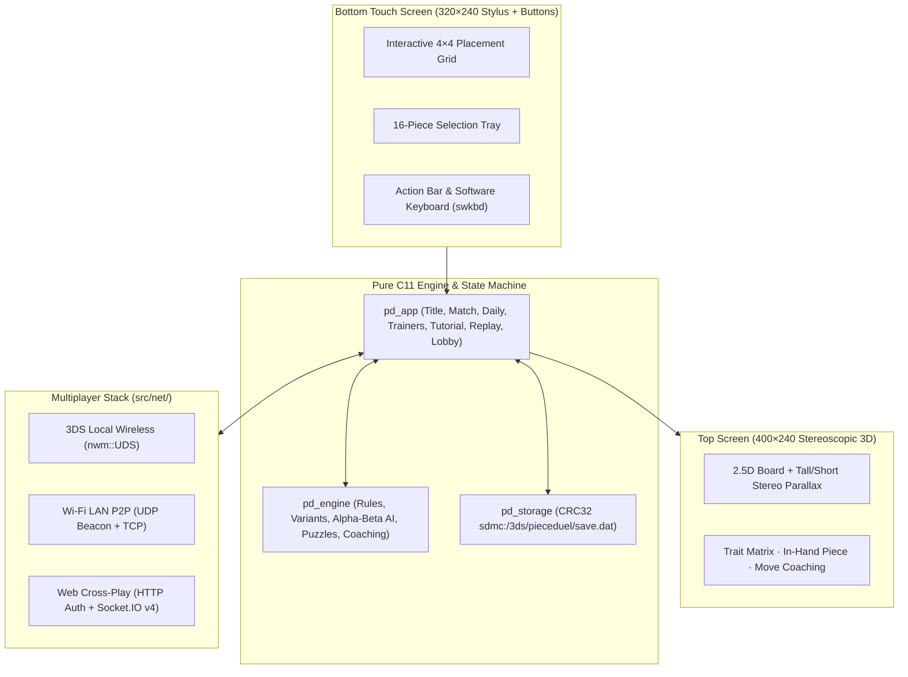

# 3ds_pieceduel

**3ds_pieceduel** is a native C11 Nintendo 3DS homebrew shared-trait
four-in-a-row abstract strategy duel (you hand your opponent the piece they must
place). Built with `libctru` and `citro2d` for Custom Firmware (CFW) 3DS
systems, it brings a stereoscopic 3D top-screen board, a stylus-driven
bottom-screen touch board and 16-piece tray, a deterministic alpha-beta AI and
tactical puzzle engine, and three-tier multiplayer (3DS Local Wireless, Wi-Fi
LAN P2P, and optional Socket.IO v4 server cross-play).

---

## Feature Matrix

| Area | Feature | Status | Implementation |
|---|---|---|---|
| **Core Engine** | 16 pieces (4 binary traits: Tall/Short, Light/Dark, Square/Round, Solid/Hollow) | Implemented | `src/engine/attributes.c`, `src/engine/rules.c` |
| **Rules Variants** | `standard` (10 lines), `misere` (completing a line loses), `advanced` (+9 2×2 squares) | Implemented | `src/engine/board.c`, `src/engine/state.c` |
| **Built-in AI** | Easy (1-ply safe give), Medium (depth-2 alpha-beta), Hard (depth-3 + exact endgame) | Implemented | `src/engine/ai.c` (Mulberry32 PRNG) |
| **Daily Puzzle** | Deterministic FNV-1a `dateSeed("YYYY-MM-DD")` + Daily Archive stepper (`L`/`R`) | Implemented | `src/engine/puzzle.c` (100% seed-compatible with Web) |
| **Tactics Trainers** | Practice, Forced Win-in-Two, Safe Give, Hot Squares (Threat Vision), Puzzle Rush | Implemented | `src/engine/forced_win.c`, `src/engine/puzzle.c` |
| **Learn & Review** | 3-step Interactive Tutorial + Post-Game Replay Scrubber & Move Coaching (`reviewMove`) | Implemented | `src/engine/tutorial.c`, `src/engine/review.c` |
| **3DS Dual Screens** | Stereoscopic 3D Top Board (`400×240`) + Stylus Touch Grid & 16-Piece Tray (`320×240`) | Implemented | `src/ui/ui_render.c`, `src/ui/ui_input.c` |
| **Multiplayer: Pass & Play** | Two players sharing one 3DS with optional beginner "hot square" threat hints | Implemented | `src/app.c` |
| **Multiplayer: 3DS Wireless** | Ad-hoc 3DS-to-3DS Local Wireless via `libctru` `nwm::UDS` (no Wi-Fi router needed) | Implemented | `src/net/net_uds.c` |
| **Multiplayer: LAN P2P** | Wi-Fi UDP beacon discovery (`:43210`) + TCP lockstep rooms (`:43211`) | Implemented | `src/net/net_p2p.c` |
| **Multiplayer: Web Cross-Play** | Connects to a compatible Socket.IO v4 server (`:4321`) over HTTP CSRF auth + WebSocket | Implemented | `src/net/net_web.c` |
| **SD Persistence** | CRC32-verified save (`sdmc:/3ds/pieceduel/save.dat`): streaks, Elo, stats, 20 replays | Implemented | `src/storage/storage.c` |
| **CFW Packaging** | `.3dsx` + `.smdh` (Homebrew Launcher / `3dslink`) and `.cia` (FBI HOME Menu install) | Implemented | `Makefile`, `Containerfile.3ds`, `meta/app.rsf` |

---

## Architecture



---

## Controls (Stylus Touch + Buttons)

| Input | Action in Match / Puzzles | Action in Menus / Replays |
|---|---|---|
| **Stylus Touch** | Tap any **4×4 Board Cell** to stage placement; tap any **Tray Piece** to hand it over; tap bottom bar (`A:ACTION`, `X:HINTS`, `Y:COLOR`, `B:BACK`) | Tap menu rows, Title bottom variant/AI selector pills, Replay halves/bar, or Multiplayer/Stats bottom bar |
| **D-Pad / Circle Pad** | Move cursor across the 4×4 board or 16-piece tray | Navigate menu items / lobby rooms / saved replays |
| **A Button** | Confirm cell placement or piece gift | Select menu item / start mode / step forward in Replay |
| **B Button** | Cancel staged placement or return to Title Menu | Back to Title Menu |
| **X Button** | Toggle between Board cursor and Piece Tray cursor (or open Replay Coaching when finished) | Cycle AI Difficulty (Title) / Edit `Host:Port` (Multiplayer) / Toggle Color-Blind palette (Stats) |
| **Y Button** | Toggle Threat ("Hot Square") Hints (or reveal answer in Daily/Trainers; tap `Y:COLOR` on bottom bar for Color-Blind palette) | Cycle AI Difficulty (Title) / Enter Invite Code (Multiplayer) / Toggle Threat Hints (Stats) |
| **L / R Shoulders** | Toggle Board/Tray focus in Match; step backward/forward in Daily Archive; cycle Trainer mode | Cycle Rules Variant (`Standard` / `Misère` / `Advanced`) on Title; step Replay Scrubber |
| **SELECT** | Offer / accept Rematch (or quick restart against AI) | — |
| **START** | Cleanly exit to Homebrew Launcher / 3DS HOME Menu | Exit application |

---

## Prerequisites & Building (`Containerfile.3ds` or Native `devkitARM`)

### Host Prerequisites
- **3DS Packaging (`make 3ds`)**: Rootless `podman` or `docker` + `python3` (no host `devkitPro` installation required).
- **Host Unit & UI Simulation (`make test-host`)**: `gcc` (with `libasan` / `libubsan`) and `make`.
- **Compatibility & Network Test Suite (`make test-compat`)**: Node.js $\ge 22.15$ (runs automated LAN P2P, UDS simulation, Socket.IO v4 protocol tests, and deterministic engine parity checks).

The build requires **zero host privileges**: if `DEVKITARM` is not installed on
the host, `make 3ds` automatically builds inside an OCI container
(`Containerfile.3ds`, compatible with `podman` or `docker`).

```bash
# 1. Build 3DS ARM11 packages (.elf, .smdh, .3dsx, and .cia)
make 3ds

# 2. Verify ELF architecture, SMDH icon metadata, 3DSX header, and CIA structure
make verify-3ds
```

Artifacts are written to `build/3ds/`:
- `build/3ds/3ds_pieceduel.3dsx` (`.3dsx` = Homebrew Launcher executable) + `build/3ds/3ds_pieceduel.smdh` (`.smdh` = 3DS icon/title metadata) — launch from **The Homebrew Launcher** or push live over Wi-Fi via `3dslink`.
- `build/3ds/3ds_pieceduel.cia` (`.cia` = CTR Importable Archive package) — install directly to the 3DS HOME Menu using **FBI** (the standard CFW 3DS package installer).

---

## Loading on a CFW 3DS

> **Note on `sdmc:/`**: In 3DS homebrew, `sdmc:/` refers to the root directory of your 3DS microSD card.

### Option 1: FBI QR Code / Network Server (`../serve_3ds.py` or `make qr`)
1. Start the shared 3DS Homebrew QR & FBI Hub (auto-discovers all `.cia` and `.3dsx` packages under `/home/lafiamafia/homebrew/3ds/`):
   ```bash
   make qr
   # or from /home/lafiamafia/homebrew/3ds:
   python3 ../serve_3ds.py
   ```
2. On your 3DS, open **FBI → Remote Install → Scan QR Code** and scan the QR code printed in your terminal (or open `http://<your-lan-ip>:8765/` in a browser for a crisp SVG QR code and one-click **Push to FBI (:5000)**).

### Option 2: Wireless Netload via `3dslink` (Fastest for Iteration)
1. Open **The Homebrew Launcher** on your 3DS and press **Y** to open the `3dslink` receiver (note the IP shown on screen).
2. Run:
   ```bash
   make netload IP=192.168.1.XXX
   ```

### Option 3: SD Card (`.3dsx` or `.cia`)
- **Homebrew Launcher (`.3dsx`)**: Copy `build/3ds/3ds_pieceduel.3dsx` and `build/3ds/3ds_pieceduel.smdh` to `sdmc:/3ds/pieceduel/` on your microSD card.
- **HOME Menu (`.cia`)**: Copy `build/3ds/3ds_pieceduel.cia` to `sdmc:/cias/` on your microSD card, open **FBI** on your 3DS, select **SD → cias → 3ds_pieceduel.cia → Install and delete CIA**.

---

## Multiplayer Guide

From the Title Menu, select **`5. MULTIPLAYER (UDS/LAN/WEB)`**:

1. **Pass-and-Play (Single 3DS)**: Choose **`2. PASS & PLAY (2P)`** directly from the Title Menu and pass the console after each turn.
2. **3DS-to-3DS Local Wireless (`UDS`)**: Choose **`1. HOST 3DS LOCAL WIRELESS (UDS)`** on one 3DS and **`2. JOIN 3DS LOCAL WIRELESS (UDS)`** on the second 3DS. Uses Nintendo's local ad-hoc wireless (`nwm::UDS`, comm ID `0x50443344`) — no Wi-Fi router needed.
3. **Wi-Fi LAN P2P (`UDP/TCP`)**: Choose **`3. HOST LAN P2P ROOM (UDP/TCP)`** on one device and **`4. SCAN & JOIN LAN P2P ROOM`** on another 3DS or PC host running on the same Wi-Fi network.
4. **Cross-Play over HTTP / Socket.IO Server**:
   - **Important on physical 3DS hardware**: The default server address `127.0.0.1:4321` is for local host/emulator testing; on a physical 3DS, press **X** (or tap **`X:HOST IP`** on the bottom bar) in the Multiplayer screen to open the 3DS software keyboard (`swkbd`) and enter your LAN server's IP and port (e.g. `192.168.1.50:4321`).
   - Select **`5. WEB SERVER CREATE ROOM (LOGIN)`** (prompts for username/password via `swkbd` if not yet signed in, then creates a room and displays its 6-character invite code) or **`6. WEB SERVER JOIN / MATCHMAKE`** (or press **Y** / tap **`Y:INVITE`** to join a 6-character invite code directly; leave the prompt blank on row 6 to enter Ranked Matchmaking).

---

## Automated Compatibility & Verification Suite

We validate engine determinism, network protocol interoperability, UI rendering,
ARM11 binary packaging, and documentation integrity automatically without
requiring physical 3DS hardware in the loop:

```bash
# Run native C11 unit tests + headless dual-screen UI/stereo simulation (with ASan/UBSan)
make test-host

# Run deterministic engine parity suite + automated LAN P2P, UDS simulation,
# and Socket.IO v4 Web Cross-Play integration tests
make test-compat

# Run all host + compatibility tests
make test

# Run deterministic documentation structure and link check
bash scripts/check-docs.sh
```

---

## Documentation Index

- **Operational & Build Guide**: [`AGENTS.md`](AGENTS.md)
- **Implementation Plan & Task Ledger**: [`IMPLEMENTATION_PLAN.md`](IMPLEMENTATION_PLAN.md)
- **Architectural Constitution**: [`specs/CONSTITUTION.md`](specs/CONSTITUTION.md)
- **Domain Glossary**: [`specs/CONTEXT.md`](specs/CONTEXT.md)
- **Documentation Audit Trail**: [`docs/audit/README.md`](docs/audit/README.md)

---

## Safety & Legal Notes

- **Save Data Integrity**: Save data in `sdmc:/3ds/pieceduel/save.dat` is protected by an IEEE 802.3 CRC32 checksum; corrupted or mismatched save versions safely fall back to clean defaults without crashing.
- **Legal**: `3ds_pieceduel` is an independent project and is not affiliated with, endorsed by, or sponsored by Gigamic or Nintendo.
